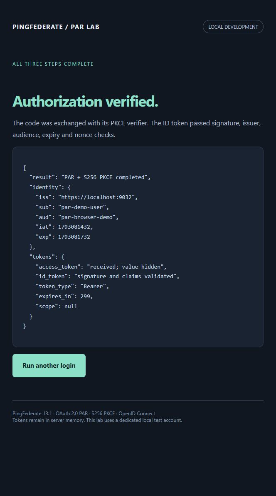

# Local deployment verification

Verified on 27 October 2026 on this workstation using Docker Desktop Linux
containers, Terraform 1.16.5, PingFederate provider 1.9.0 and Docker provider 4.6.0.

- Both Terraform roots initialized and validated; formatting check passed.
- PingFederate image `pingidentity/pingfederate:2606-13.1.0` deployed as
  `pf-par-poc`, healthy, with a separate persistent volume and loopback ports.
- Trusted localhost TLS imported, selected and verified after a PF restart.
- Ten mock-provider HTTP/OIDC and curl-guide route tests passed.
- Six live PF protocol tests passed, including wrong-verifier rejection after
  real local login, consent and code issuance.
- The in-app browser completed PAR, sign-in as `par-demo-user`, consent,
  authorization-code exchange with S256 PKCE, and signed ID-token validation.
- The result showed issuer `https://localhost:9032`, subject `par-demo-user`,
  audience `par-browser-demo`, and Bearer token metadata. Token values were hidden.
- Final configuration and runtime plans reported no changes.

The curl request/response guide is served at `/curl` with a Markdown version at
`/curl.md`. Its response statuses and form/token field names were checked against
a complete local login/code/token flow without printing sensitive values. The
PowerShell examples parse successfully. Windows curl discovery and PAR commands
returned HTTP 200 and HTTP 201 with trusted TLS and Schannel best-effort handling
for the local certificate's missing revocation information.

The guide's PowerShell/Bash switch uses the `shell` query flag and selects the
matching Markdown source. Every Bash code block passed `bash -n`; the Bash/OpenSSL
PKCE setup also ran successfully in Git Bash with 43-character verifier/challenge
values. Integration checks cover shell selection, shell-specific downloads and
rejection of unknown shell values.

The runtime explicitly selects Docker Desktop's Linux-engine pipe. The generic
Windows Docker pipe returned HTTP 500. Docker's automatic address pools were
exhausted, so this project uses `10.233.0.0/24`, which did not overlap its existing
Docker networks. Docker Desktop was not restarted.

`terraform/runtime` includes a small `terraform_data` local-exec reconcile step
for the demo image. The Compose provider does not detect an image replacement
behind the same tag; this step runs `docker compose --profile demo up --detach
--no-deps demo` after image changes, preserving the PF container.
